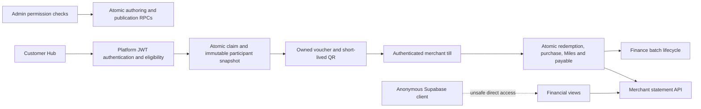

# Multi-merchant vouchers: architecture, robustness, security and HCI audit

**29 October 2026 · Verdict: not ready for public release.**

The core model is sound: claim-time merchant snapshots, database-enforced claims, one atomic checkout, and append-only funding/payable records. However, this audit found **13 findings: six High and seven Medium**. The most urgent are anonymously readable financial views, duplicate concurrent settlement batches, and stale batch amounts surviving reversals. Passing checkout tests did not cover these boundaries.

This is a feature audit of the current working trees and the verification branch, not a certification or a complete infrastructure penetration test. No application fixes or migrations were applied during the audit. No production records were read: main access was limited to permission/view metadata in a read-only transaction. All synthetic-branch mutation probes were rolled back. No payment was initiated or recorded.

## Remediation status

Subsequent work closed A01 on verification branch `urjamfbtlzycetvuvwpg` using Platform migration 160, covering nine private financial views. Forty real REST access checks, 87 funded integration tests, and the Hub typecheck passed; Merchant B's scoped KES100 statement still works. **Main remains pending rollout.** See [remediation and production rollout](a01-private-financial-view-remediation.md). Counts and evidence below describe the original audit; subsequent repairs are recorded in this section.

A02 was subsequently fixed on the same verification branch using Platform migration 161. Committed two-connection tests prove one live batch membership, including Repeatable Read/direct-insert paths; branch probes used rolled-back server-role transactions. Production rollout remains pending. See [A02 remediation](a02-unique-live-batch-membership-remediation.md). A03 was subsequently fixed on the branch using migration 162: per-item/net-total validation, shared payable locks, and snapshot-safe revisions. Stale actions are refused without changing state; cancellation/rebuild uses current amounts. See [A03 remediation](a03-settlement-revalidation-remediation.md). Production rollout remains pending.

A04/A05 were subsequently fixed on the verification branch using migrations 163/164: issued funded validity is independent of acquisition pause/end/window, explicit revocation still blocks, and merchant/direct service-role edits to managed templates and their locations are refused. Real branch presentation/checkout probes were rolled back; 119 funded integration tests and 19 targeted merchant-route tests passed. Production rollout remains pending. See [A04/A05 remediation](a04-a05-issued-lifecycle-and-managed-template-remediation.md).

A06 was subsequently repaired in the working tree: production worker navigation caching/fallback was removed, historical page/asset caches are purged, and logout/account changes discard private document/router state. A real Chromium A → logout → B/offline exercise used the exact production worker and synthetic branch auth; 24 new privacy tests passed. Production app/worker deployment remains pending. See [A06 remediation and verification limits](a06-private-navigation-cache-remediation.md).

A07–A09 and A13 were subsequently repaired in the working tree with a shared customer entitlement DTO, distinct claim/validity/issued dates, immutable owned conditions, guarded keyboard transitions, accessible action colors and 44px merchant/disclosure controls. Final Chromium checks cover the full catalogue, nine axe states/surfaces and real branch-owned QR presentation; no new claims or redemptions were made. Production deployment remains pending. See [customer entitlement remediation](a07-a09-a13-customer-entitlement-remediation.md).

A10–A12 were subsequently repaired in the working trees and verification branch (Platform 165): safe streamed CSV export, explicit funded-discovery availability errors, aggregate-only Home balances and bounded keyset history. The named voucher-pricing test is reconciled. Production-build customer/merchant journeys, real RPC denial checks and 492 integration tests passed. Broader unit-suite failures, branch Merchant Terms readiness and production rollout remain blockers. See [statement/discovery remediation and release evidence](a10-a12-statements-discovery-remediation.md).

The subsequent failing-test triage is complete: 331 merchant unit tests and 1,127 Hub unit tests pass (one Hub skip), with clean typechecks. The 12 failures were stale fixtures/expectations; runtime guards were preserved and additional rejection tests added. See [release test triage](release-test-triage-2026-10-29.md). These test failures no longer block release.

The Karen Flea Market production-build acceptance journey subsequently passed on the verification branch: authenticated admin authoring/approval/publication, actual customer claim, exact event-date refusal, separate successful rehearsal checkout at secondary B, replay and independent accounting/statement checks. It uncovered and fixed dropped participant RPC arguments, ambiguous admin merchant joins and draft timezone shifts. Migration 114 adds bounded event dates. See [Karen setup and acceptance evidence](karen-flea-market-acceptance-2026-10-29.md). Production remains unchanged.

## Scope and architecture

Reviewed MiniMiles Hub and admin routes, Platform merchant routes, Platform claim API, migrations 113 and 154–159 and their relevant predecessors, presentation tokens, compatibility guards, discovery/owned serializers, authoring, readiness, checkout, settlement and reimbursement UI.

The principal architectural weakness is that safeguards are strongest inside the new claim/checkout RPCs, while older views, editing routes, template lifecycle rules and settlement routines still expose or mutate the same data through different assumptions.

## High severity findings

### A01 — Anonymous clients can read financial statements directly

**Rule:** server authorization must cover every data-access path, including database views. **Evidence: confirmed in a branch REST request; matching unsafe grants confirmed on main.**

An anonymous REST request with only the public publishable key returned HTTP 200 and the synthetic merchant's ID, receipt reference `VERIFY-B-001`, and payable amount 10000 minor units. Four examined views allow SELECT to both `anon` and `authenticated`: `v_merchant_voucher_reimbursement_statement`, `v_voucher_payable_net_amounts`, `v_unbatched_voucher_payables` and `v_partner_settlement_batches`. Their owner is `postgres`, with no `security_invoker` option. Main has the same metadata; no main data query was performed.

**Impact:** merchant financial and receipt data can be read outside the session-scoped dashboard API. Restricting the new RPC does not close the old view endpoints. Base-table RLS is insufficient for these owner-context views.

**Location:** [supabase/migrations/158_merchant_reimbursement_balances.sql:4](</Users/ibraziz21/Desktop/Work/Akiba-Platform/supabase/migrations/158_merchant_reimbursement_balances.sql:4>); deployed ACL evidence is recorded separately under ignored `.verification/feature-audit-db-access.json`.

**Fix:** revoke anonymous/authenticated access to the private financial views, preserve service-role access, and audit their dependencies/default grants. Consider moving internal financial objects to a non-exposed schema or applying appropriate invoker semantics throughout the view chain. Add real anon/other-merchant REST denial tests, not only tests of the new RPC's grants.

**Qualification:** branch data exposure is proven; main metadata establishes the unsafe database posture, not whether production currently contains exposed rows or has an additional API-layer restriction. [Supabase view security](https://supabase.com/docs/guides/database/views) explains the owner/invoker distinction.

### A02 — Concurrent batch creation can assign one payable to two live batches

**Evidence: reproduced using two open branch transactions.**

Both calls to `create_voucher_reimbursement_batch_atomic` returned distinct successful draft batches for the same redemption before either transaction committed. The trigger checks for existing live membership with an ordinary SELECT; it does not serialize access to the redemption. Each transaction cannot see the other's uncommitted item. Both transactions were rolled back; no duplicate batch was committed.

**Impact:** concurrent finance actions can create duplicate payable obligations and permit duplicate settlement. The statement view can subsequently contain duplicates, causing the new statement API to fail closed with 503 rather than display a balance.

**Locations:** [supabase/migrations/119_voucher_funding_payables.sql:65](</Users/ibraziz21/Desktop/Work/Akiba-Platform/supabase/migrations/119_voucher_funding_payables.sql:65>); [supabase/migrations/121_voucher_funding_batches_and_reversal.sql:29](</Users/ibraziz21/Desktop/Work/Akiba-Platform/supabase/migrations/121_voucher_funding_batches_and_reversal.sql:29>).

**Fix:** lock the same stable redemption/payable row for every batching operation, in deterministic order, or use an equivalent enforceable reservation model with uniqueness. Cover the invariant across all entry points. Add a two-connection test that attempts to commit both and proves exactly one live membership remains in a disposable database.

### A03 — A stale batch can be submitted after its payable has been reduced

**Evidence: reproduced with real RPCs in one rolled-back transaction.**

Created a KES100 batch, partially reversed KES60, then submitted the batch successfully. The submitted batch still held `total_amount_minor=10000`, while the current net payable was `4000`. Submission validates only that the stored total is positive; payment checks references/evidence, not current per-item entitlement.

**Impact:** finance can approve or pay KES100 against a remaining KES40 obligation. The merchant UI's net balance and the transfer batch amount can disagree.

**Locations:** [supabase/migrations/121_voucher_funding_batches_and_reversal.sql:70](</Users/ibraziz21/Desktop/Work/Akiba-Platform/supabase/migrations/121_voucher_funding_batches_and_reversal.sql:70>); reversal logic in the same migration.

**Fix:** coordinate reversal and settlement with common locks. Validate/reconcile each item and the batch total at submit and immediately before payment. For submitted batches, explicitly block payment and require cancellation/rebuilding or a documented adjustment path. Preserve original financial history. Add reversal-before-submit and reversal-before-pay tests.

### A04 — Claim availability and issued-voucher redemption share the wrong lifecycle gate

**Evidence: allocation-pause failure reproduced; claim-end expiry coupling established in source.**

A valid presentation inspected successfully. Pausing its allocation made inspection return no valid row, while the voucher remained `issued` and unexpired. Allocation transition writes the shared template inactive; inspect/redeem require that template to remain active and published. This contradicts the specification's explicit promise that an allocation pause does not invalidate an issued voucher.

The same class of coupling affects time windows: allocation creation writes the claim window into template `start_at/end_at`; redemption checks the live template end as well as the voucher expiry. A voucher claimed near the deadline can therefore stop working at the claim deadline before its promised post-claim validity ends.

**Locations:** [supabase/migrations/156_allocation_publication_readiness.sql:164](</Users/ibraziz21/Desktop/Work/Akiba-Platform/supabase/migrations/156_allocation_publication_readiness.sql:164>); [supabase/migrations/157_kes_voucher_legacy_product_id_compatibility.sql:44](</Users/ibraziz21/Desktop/Work/Akiba-Platform/supabase/migrations/157_kes_voucher_legacy_product_id_compatibility.sql:44>); [Platform migration 117](/Users/ibraziz21/Desktop/Work/Akiba-Platform/supabase/migrations/117_voucher_funding_allocation_lifecycle.sql:71) writes `p_claim_starts_at,p_claim_ends_at` to the template.

**Fix:** separate acquisition availability from an issued voucher's redemption entitlement. Use its immutable benefit/schedule, own expiry and explicit revocation/funding-suspension policy. Add claim → pause → redeem and claim-close → still-unexpired → redeem regressions. Preserve intentional emergency suspension through a distinct, clearly named control.

### A05 — Merchant editing can alter an Akiba-managed funded template

**Evidence: source-confirmed route path; lack of database guard checked in a rolled-back branch update.**

The ordinary merchant template PATCH authorizes by primary `partner_id`, but does not reject `managed_by='akiba'` or funded allocations. Its allowed fields include discount percentage, category/product restrictions, active flag and end time. The database accepted changing the synthetic funded template's percentage to 25 while retaining `managed_by='akiba'` and `funding_mode='akiba_reimbursement'`.

**Impact:** the primary merchant's owner/admin can alter centrally managed future offer terms or disable/shorten a shared template affecting all participating merchants. Previously snapshotted percentages remain frozen, but the live active/end gates still affect issued vouchers. This is a privilege-boundary failure, not a claim that the merchant can change another arbitrary merchant's template.

**Location:** [packages/dashboard-merchant/app/api/merchant/voucher-templates/[id]/route.ts:94](</Users/ibraziz21/Desktop/Work/Akiba-Platform/packages/dashboard-merchant/app/api/merchant/voucher-templates/[id]/route.ts:94>).

**Fix:** reject ordinary PATCH/DELETE/publish mutations on managed funded templates and route changes through the authorized funding lifecycle. Add database enforcement where possible, with an explicit privileged authoring path. Regression-test actual primary merchant credentials against all mutable funded fields. The audit did not send a committing HTTP PATCH.

### A06 — Service worker caches private voucher HTML across sessions

**Rule:** authenticated data must not survive account switching in shared navigation caches. **Evidence: exact worker source exercised in a controlled VM harness; browser account-switch exploit not run.**

The production service worker caches every successful navigation, including responses with `Cache-Control: private, no-store`, and returns cached HTML when offline. Cache keys are navigation URLs rather than user identities. Logout does not clear these page caches. The harness proved that an offline navigation to the same URL returns the prior synthetic session's private HTML despite its no-store header.

**Impact:** a subsequent user of the same browser profile can see a previous user's voucher metadata or serialized detail props when offline. This is a privacy leak, not proof that they can mint a presentation token or redeem another user's voucher. Development-only registration suppression does not protect production.

**Locations:** [packages/hub-page/public/sw.js:74](</Users/ibraziz21/Desktop/Work/MiniMiles/packages/hub-page/public/sw.js:74>); [packages/hub-page/src/app/(protected)/me/SignOutButton.tsx:12](</Users/ibraziz21/Desktop/Work/MiniMiles/packages/hub-page/src/app/(protected)/me/SignOutButton.tsx:12>).

**Fix:** do not persist authenticated HTML/RSC payloads in shared caches. Keep offline resources public and explicit, or use a tightly scoped, separately designed account-bound offline Pass representation. Clear legacy caches on upgrade/logout/account change. Test A → logout → B/offline with real production worker behavior.

## Medium severity findings

### A07 — Claim confirmation misstates both expiry and merchant coverage

**Evidence: source-confirmed, not a newly completed claim.** The card passes only `offer.merchant.name` and `claimEndsAt`; the modal renders “Redeemable at [primary] · use by [claim deadline].” The actual scope includes multiple merchants and the issued expiry is calculated from `voucher_validity_seconds` after claim. The synthetic allocation's claim window and seven-day voucher validity are different.

**Impact:** the decisive confirmation step contradicts the participant list and can give a customer the wrong date for planning a visit.

**Locations:** [packages/hub-page/src/components/vouchers/FundedOfferCard.tsx:206](</Users/ibraziz21/Desktop/Work/MiniMiles/packages/hub-page/src/components/vouchers/FundedOfferCard.tsx:206>); [packages/hub-page/src/components/vouchers/ClaimOfferButton.tsx:51](</Users/ibraziz21/Desktop/Work/MiniMiles/packages/hub-page/src/components/vouchers/ClaimOfferButton.tsx:51>); [packages/hub-page/src/components/vouchers/VoucherEligibilityModal.tsx:100](</Users/ibraziz21/Desktop/Work/MiniMiles/packages/hub-page/src/components/vouchers/VoucherEligibilityModal.tsx:100>).

**Fix:** pass the participant set/count and explicit claim deadline plus validity duration. Label them separately (“Claim by …”, “Valid for … after claiming”); use the committed expiry on success. Confirming should never substitute the primary merchant for the full set.

### A08 — Owned vouchers omit the cap, minimum spend and full terms

**Evidence: source and rendered owned-voucher page.** The claimed fixture's detail shows its percentage and merchant set, but neither KES200 maximum discount nor KES300 minimum spend. The server detail DTO omits these snapshot fields, and `dealLabel` renders only the percentage. Full terms are also absent from this detail payload.

**Impact:** a customer cannot reliably check the purchase conditions at the counter; the screen can suggest an unrestricted percentage discount.

**Locations:** [packages/hub-page/src/app/vouchers/[id]/page.tsx:101](</Users/ibraziz21/Desktop/Work/MiniMiles/packages/hub-page/src/app/vouchers/[id]/page.tsx:101>); [packages/hub-page/src/lib/akiba/deals.ts:39](</Users/ibraziz21/Desktop/Work/MiniMiles/packages/hub-page/src/lib/akiba/deals.ts:39>).

**Fix:** include immutable cap, minimum spend, terms and any scope restrictions in one owned-voucher display contract and use it on detail, wallet and QR views. Test a title that does not itself contain the conditions, so accidental title text cannot mask missing fields.

### A09 — Dialog keyboard behavior captures stale close state

**Evidence: source-confirmed closure/dependency defect; submitting-state keyboard behavior not reproduced in this browser run.** `useDialogA11y` installs its Escape handler only when `open` changes. The modal changes `onClose` to undefined while submitting, but the effect retains the earlier callback. Escape can still invoke the older `closeModal`, whose captured status predates `claiming`. When every child is disabled, the Tab trap also returns without preventing focus from leaving.

**Impact:** a customer may dismiss or tab out of a supposedly non-dismissible submission dialog while a claim is in flight, then misread its outcome or retry.

**Locations:** [packages/hub-page/src/hooks/useDialogA11y.ts:67](</Users/ibraziz21/Desktop/Work/MiniMiles/packages/hub-page/src/hooks/useDialogA11y.ts:67>); [packages/hub-page/src/components/vouchers/VoucherEligibilityModal.tsx:58](</Users/ibraziz21/Desktop/Work/MiniMiles/packages/hub-page/src/components/vouchers/VoucherEligibilityModal.tsx:58>).

**Fix:** keep current close permission/callback in a ref or update the effect safely; prevent Escape default when appropriate and handle zero focusable elements by retaining focus on the dialog container. Add keyboard tests spanning checking → eligible → submitting → success/failure, including a deliberately slow response.

### A10 — Statement CSV permits spreadsheet formulas in text cells

**Evidence: source-confirmed output behavior; no spreadsheet execution performed.** Receipt and payment references are copied into CSV with quote escaping only. A reference starting with `=`, `+`, `-` or `@` can be interpreted as a formula by spreadsheet software even in a quoted CSV cell. Receipt references are accepted as merchant-provided text.

**Impact:** malicious or imported reference text can execute spreadsheet formulas when a statement is opened. Exact effects depend on the spreadsheet application and its protection settings; this is not evidence of application-side JavaScript or SQL execution.

**Location:** [packages/dashboard-merchant/components/billing/AkibaReimbursementsTab.tsx:30](</Users/ibraziz21/Desktop/Work/Akiba-Platform/packages/dashboard-merchant/components/billing/AkibaReimbursementsTab.tsx:30>).

**Fix:** export text as literal cells using a safe spreadsheet format, or use a documented CSV formula-neutralization policy appropriate for the supported spreadsheet apps, including whitespace/control prefixes. Add malicious-reference export tests. [OWASP CSV injection](https://community.owasp.org/attacks/CSV_Injection).

### A11 — Discovery outages look like “no offers”

**Evidence: source-confirmed.** Catalogue failures return an empty array; membership failures withhold offers; the caller has no availability/error channel and can render “No free offers right now.” Withholding an unresolved offer is correct. Presenting the outage as a known empty inventory is not.

**Impact:** customers cannot distinguish a service outage from a genuine empty catalogue and have no useful retry path. Operators lose a visible signal of participant-resolution problems.

**Locations:** [packages/hub-page/src/lib/vouchers/catalogue.server.ts:118](</Users/ibraziz21/Desktop/Work/MiniMiles/packages/hub-page/src/lib/vouchers/catalogue.server.ts:118>); [packages/hub-page/src/lib/vouchers/fundedOfferMerchants.server.ts:90](</Users/ibraziz21/Desktop/Work/MiniMiles/packages/hub-page/src/lib/vouchers/fundedOfferMerchants.server.ts:90>).

**Fix:** return data plus explicit availability/partial-failure status, retaining fail-closed offer semantics. Show a concise retry state when the catalogue cannot be established, and add structured monitoring for withheld allocations.

### A12 — Home fetches the entire reimbursement history to show one balance

**Evidence: source-confirmed scaling risk; no production-volume load test.** The statement RPC JSON-aggregates the full merchant history, and both Home and the statement page request it. This avoids silent REST row-cap truncation but makes the common Home request grow without bound. The browser then parses all rows just to display summary totals.

**Impact:** growing merchant history increases database aggregation, response size, browser memory and time before the balance appears. Failure of a large statement can make an otherwise cheap summary unavailable.

**Locations:** [supabase/migrations/159_merchant_reimbursement_paid_totals.sql:8](</Users/ibraziz21/Desktop/Work/Akiba-Platform/supabase/migrations/159_merchant_reimbursement_paid_totals.sql:8>); [packages/dashboard-merchant/components/billing/ReimbursementBalance.tsx:32](</Users/ibraziz21/Desktop/Work/Akiba-Platform/packages/dashboard-merchant/components/billing/ReimbursementBalance.tsx:32>).

**Fix:** return an aggregate-only Home summary; paginate statement rows with stable ordering; stream/export a complete statement independently. Keep totals across the full ledger, never just the visible page. Benchmark with realistic merchant histories.

### A13 — Contrast and merchant-link target sizes fail the rendered accessibility checks

**Evidence: axe-core 4.11.1 against the expanded catalogue at 1440px; geometry checked at 320, 375, 414, 768, 1024 and 1440px.**

Axe reported two violation categories affecting ten nodes: seven contrast nodes and three target-size nodes. Examples: white on the primary teal button is 3.91:1; the green Free badge is 3.76:1; participant links are 4.43:1 on their card background. These normal-size text combinations require 4.5:1. Merchant links measured roughly 130 × 15.5px with 20px vertical row spacing; axe also found insufficient spacing for the 24px minimum target exception. The disclosure summary itself measured 16px high.

**Impact:** key controls are harder to read and merchant links harder to select accurately, especially for low-vision and touch users.

**Location:** [packages/hub-page/src/components/vouchers/FundedOfferCard.tsx:88](</Users/ibraziz21/Desktop/Work/MiniMiles/packages/hub-page/src/components/vouchers/FundedOfferCard.tsx:88>), plus shared teal/button/badge styling in the voucher hub.

**Fix:** darken text/button colors to passing combinations and provide full-row merchant links with at least 24px minimum targets/spacing, preferably 44px touch rows. Add an explicit disclosure indicator, visible focus styling and re-run contrast/target tests on real hover, selected and disabled states. [W3C target-size guidance](https://www.w3.org/WAI/WCAG22/Understanding/target-size-minimum).

## HCI fundamentals assessment

| Dimension | Assessment | Observation and action |
| --- | --- | --- |
| Clickability signals | Minor issue | Claim button is clear; native disclosure works, but list-none styling hides its usual expansion marker. Restore an explicit state indicator and larger link rows. |
| State visibility | Major issue | Unavailable discovery can appear empty; submitting dialogs retain stale keyboard close behavior. Make unknown and committed outcomes explicit. |
| CTA clarity | Minor issue | “Claim” and “My vouchers” map well to actions. Confirmation must accurately summarize all merchants, dates and restrictions. |
| Action discoverability | Minor issue | Merchant disclosure and Home reimbursement link are discoverable; the full participant list should remain available through confirmation and QR. |
| Match with the real world | Major issue | Claim deadline is labelled use-by; owned conditions disappear; paused-but-issued vouchers fail at the till. Separate the lifecycle concepts. |
| Error prevention and recovery | Major issue | Atomic checkout/replay is strong, but finance batching lacks equivalent concurrency/revalidation safeguards. |
| Recognition over recall | Major issue | Members should not have to remember the cap/minimum from the discovery card. Repeat concise conditions on the owned voucher. |
| Accessibility and responsiveness | Mixed | No catalogue horizontal overflow at six tested widths and disclosure keyboard operation passed; contrast and target sizing failed. Full assistive-technology coverage remains open. |

## Controls that held up

- Authoring wrappers combine allocation creation/update and membership replacement in one database transaction, with draft/version checks.
- Publication/resume readiness is checked in the database and gives named merchant blocking reasons; payout destination readiness is correctly advisory under the current payable-before-destination policy.
- Claim RPC independently derives canonical identity and re-evaluates persisted eligibility, country, username, schedule, quantity and budget. Caller snapshots are not trusted as authorization.
- Participant membership is snapshotted at issue and discovery resolves participants in batches without quietly shrinking the set.
- Presentation tokens use random 32-byte values, short expiry, stored hashes and owner-checked issue/revoke RPCs. Presentation responses explicitly prohibit caching.
- Redemption locks the voucher and atomically records purchase, Miles, payable, reservation release and replay response. Existing A/B competition, replay and disallowed-day rollback tests pass.
- Merchant redemption scope comes from the authenticated membership and the voucher snapshot. Reimbursement DTOs are session-scoped and use integer minor-unit totals.
- Old-client direct claims reject unsupported shapes; unknown support metadata is distinguished from an upgrade requirement; usable multi-merchant vouchers are hidden from legacy surfaces while redeemed history remains available.

These controls do not neutralize the independent financial-view exposure or settlement bugs above.

## Verification and coverage limits

| Check during this audit | Result |
| --- | --- |
| Six focused Hub test files | 68 passed |
| Three funded integration suites in disposable databases | 85 passed (37 multi-merchant, 38 percent/weekend, 10 accounting) |
| Four merchant test files | 70 passed, 1 failed |
| Anonymous branch financial-view REST probe | Exposure confirmed: HTTP 200 |
| Main metadata-only view ACL inspection | Same unsafe grants/owner configuration confirmed; no production rows queried |
| Pause/issued-voucher probe | Failure confirmed, rolled back |
| Concurrent settlement and stale-batch probes | Both failures confirmed, rolled back |
| Production worker source harness | Private/no-store HTML cache reuse confirmed in controlled harness |
| Catalogue geometry/keyboard | Six widths fit; native disclosure keyboard activation passed |
| Axe scan | Two violation categories, ten affected nodes; 27 checks passed, one incomplete result |
| Owned detail inspection | Missing cap and minimum spend confirmed |

The failing merchant test is `kes-vouchers.test.ts`, “fails publishing closed when Akiba has not selected the exact band price”: expected 503, received 400. Its fixture supplies `applicable_category: "food"`; the current allowed category is `food_drink`, so validation rejects this input before the mocked pricing RPC. Treat the red test as unresolved validation/test-contract evidence, not proof that the funded checkout fails and not an asserted pre-existing failure. No test was edited to make the audit green.

No production build, authenticated admin browser flow, real camera scan, real payment transfer, browser account-switch/offline reproduction, production-volume performance trace, 200% zoom/screen reader run or full infrastructure/dependency penetration test was completed here. Local previews run in development mode; the approximately 1.54s initial navigation TTFB observed once is not a production Core Web Vitals benchmark or field-performance result. No Lighthouse score is claimed. The referenced web-quality skill's measurement companion was unavailable; runtime geometry, axe and source inspection were used instead.

Existing release checks still apply: reconcile production migration history/order; independently review/deploy Merchant Terms migration 153 (the verification preview still shows its existing 503 warning); complete the staged operational matrix. Admin open-access mode must be explicitly disabled for deployed environments; the current code permits an explicit `ADMIN_OPEN_ACCESS=true` override even in production ([packages/admin-dashboard/src/lib/auth.ts:9](</Users/ibraziz21/Desktop/Work/MiniMiles/packages/admin-dashboard/src/lib/auth.ts:9>)). No deployed environment setting was inferred or exposed. Legacy detail ownership also reads linked wallets without filtering verification ([packages/hub-page/src/app/vouchers/[id]/page.tsx:34](</Users/ibraziz21/Desktop/Work/MiniMiles/packages/hub-page/src/app/vouchers/[id]/page.tsx:34>)); newly funded vouchers store `user_address=NULL`, so this is an adjacent historical-voucher risk requiring separate reproduction, not a demonstrated funded-voucher takeover.

Private sanitized probe outputs live under ignored `.verification/feature-audit-*.json`, with screenshots under ignored `output/playwright/feature-audit-*.png`. No credentials or raw presentation tokens appear in this report.

## Recommended repair order and exit criteria

1. **Contain A01:** close public financial-view access, inspect other finance-view grants, and verify anon/authenticated/cross-merchant REST denial while the merchant BFF still works. Do not delay this behind visual polish.
2. **Repair A02/A03 together:** serialize payable reservation, reversal and payment transitions; prove one live batch per redemption and refuse stale amounts under two-connection tests.
3. **Repair A04/A05:** separate acquisition/redemption lifecycle and lock down managed-template edits. Prove pause and claim-window closure preserve issued validity; explicit revocation still blocks.
4. **Repair A06:** prevent private navigation caching and purge historical page caches. Prove shared-device logout/offline isolation using the production worker.
5. **Repair A07–A09 and A13:** use one customer entitlement DTO through card, confirmation, owned and QR screens; distinguish claim deadline from validity; fix keyboard transitions, contrast and touch targets.
6. **Repair A10–A12:** safe exports, explicit unavailable states and bounded statement loading. Reconcile the red merchant test and run production-build journeys before release.

Release should remain blocked until High findings are resolved and regression-tested, the customer entitlement/expiry disclosures are correct, and the remaining staged verification gates are satisfied. A percentage-complete estimate would conceal the severity of the remaining risks.
